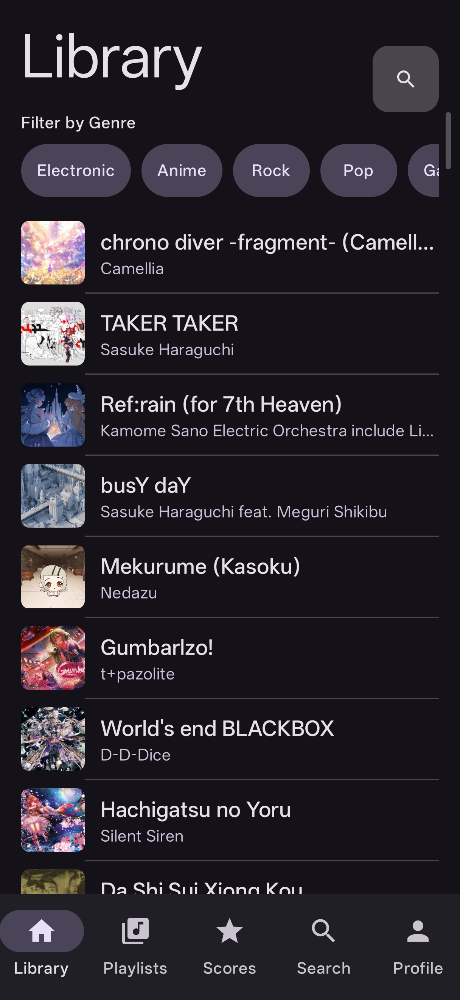
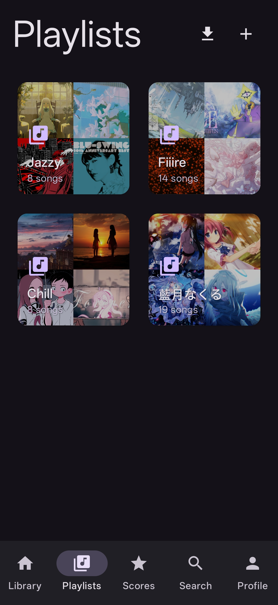
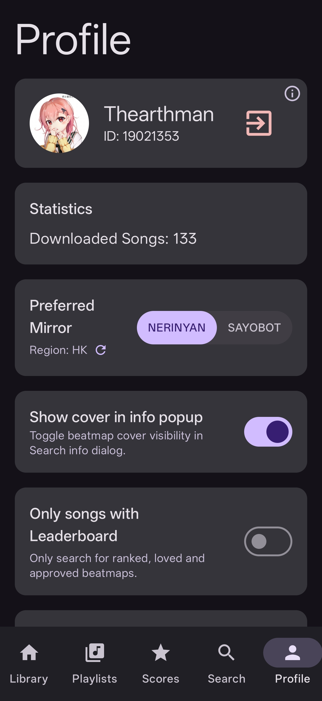
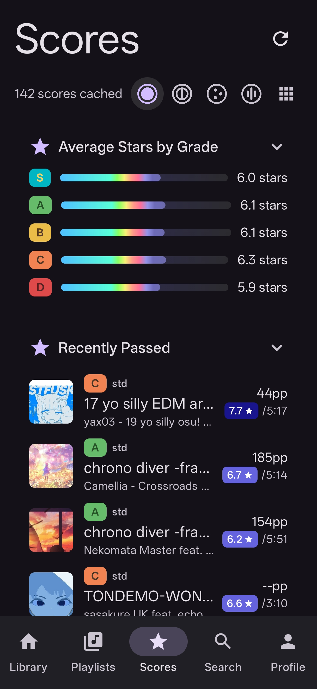
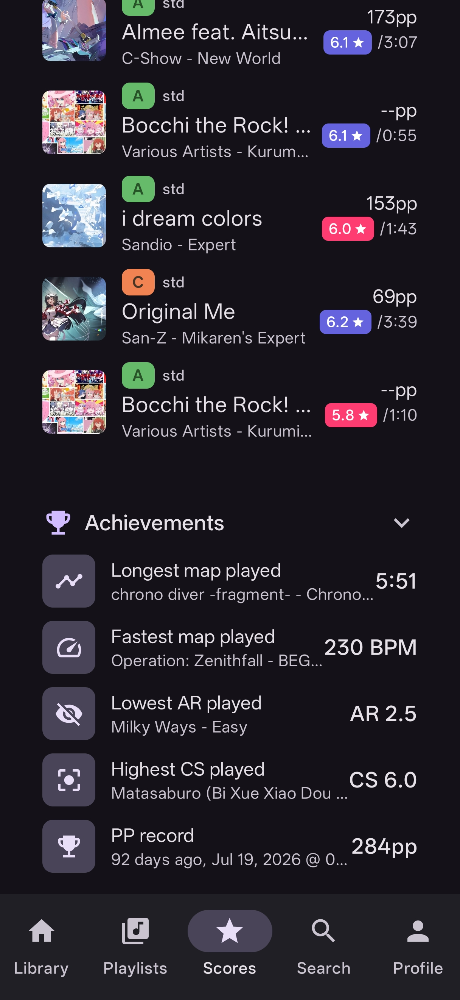

# Mosu — an offline osu! beatmap library for Android

**中文版**: [README_zh.md](README_zh.md)

## Introduction
Mosu lets you sign in with your osu! account, browse the beatmaps you've played or favorited, download them from public mirrors, and build an offline collection. It extracts audio and cover art from each `.osz`, stores beatmap metadata in Room, and plays the extracted audio with Media3/ExoPlayer.

## Download
📥 **Latest Release**: [Download from GitHub Releases](https://github.com/Thearthman/mosu/releases/latest)

## UI and Page design

  
  
  
  

### Features
- OAuth login with automatic token refresh and credential management.
- Search views (selectable and persisted): Played, Recent (with timestamps), Favorite, Most Played, All; global "include unranked (s=any)" toggle in Profile.
- Advanced search: merge duplicate beatmapsets by title/artist, enhanced info popups showing all matching beatmapsets from osu API (difficulties, star ratings, game modes), color-coded difficulty gradients, manual cache refresh (pull-to-refresh).
- Per-item download progress; downloaded items tap-to-play from Search/Library. Undownloaded items: tap to play preview; preview stops when starting full playback (from search, info popup, or MiniPlayer).
- Downloaded beatmaps in Search: swipe left to delete, swipe right to add to playlist (playlist selector dialog), same as Library.
- Library with genre filter, search bar, and a current-track locator that scrolls/highlights the playing track; swipe-to-delete or add to playlists.
- Playlists: create custom playlists, add/remove beatmaps, drag to rearrange playlist cards, long-press to rename/delete playlists, playlist-specific playback modes.
- Player: background playback (Media3), collapsible MiniPlayer with controls, expandable full player view; mod selector (NM/DT/NC) with persistence, deterministic shuffle cycling, playback mode persistence (single/loop/random).
- Profile: user info, downloaded count, default search view setting, include-unranked toggle, OAuth credentials management, language selector following system locale.
- UI polish: refined media-player-inspired design, dark mode, gamemode icons in search results, individual difficulty titles in player, smooth animations, no divider lines.

## Scores
The **Scores** tab turns your cached osu! recent plays into a compact dashboard. Scores are synced across standard, taiko, catch, and mania, then filtered with the mode icons; the selected mode is persisted. Up to 500 recent plays are kept locally, and the dashboard can be refreshed manually or by the daily background sync.

  
  

- **Average Stars by Grade**: groups passed scores by grade (SS, S, A, B, …) and shows the average star rating for each grade.
- **Recently Passed**: lists up to 30 passed scores, newest first, with grade, mode, difficulty, PP, star rating, and map length. Long-press a row to open the beatmapset info popup.
- **Achievements**: highlights the longest map, fastest BPM, lowest AR, highest CS, and the best PP play among cached passed scores.

> Score statistics come from the cached recent-score history (up to 500 plays), not your complete osu! profile history.

## Standby Player
In landscape, the full player becomes a wide CarPlay-style standby screen with large cover artwork, track details, transport controls, progress, mods, and shuffle controls.

  

## Renderer attribution

The Full Player's osu!standard preview uses the bundled **vv_idke_trail** skin,
version **2.4**, by **[Garin] + Aristia + Various**. It was obtained from
[SkinHub](https://skinhub.com/); the supplied skin files are also available in
[bontalor/lor-osu-skin](https://github.com/bontalor/lor-osu-skin).

Rendering behavior and timing formulas were adapted from [ppy/osu](https://github.com/ppy/osu)
at commit [`4e11ab19feb423c905cf98d9b8fa34700a8aeffa`](https://github.com/ppy/osu/tree/4e11ab19feb423c905cf98d9b8fa34700a8aeffa),
with reference to:

- `osu.Game.Rulesets.Osu/Objects/Slider.cs`
- `osu.Game.Rulesets.Osu/Objects/Drawables/DrawableOsuHitObject.cs`
- `osu.Game.Rulesets.Osu/Objects/Drawables/DrawableSlider.cs`
- `osu.Game.Rulesets.Osu/Skinning/Default/SpinnerRotationTracker.cs`
- `osu.Game/Rulesets/Objects/SliderPath.cs`
- `osu.Game/Beatmaps/IBeatmapDifficultyInfo.cs`

ppy/osu is distributed under the MIT license; see its `LICENCE` file.

## Setup Tutorial

### 1. Prerequisites
- An osu! account, from which you will need to get OAuth app credentials (client ID/secret) from https://osu.ppy.sh/home/account/edit. 

> **IMPORTANT**: How to get your OAuth keys:
> 1. Go to https://osu.ppy.sh/home/account/edit
> 2. Scroll down to find the "OAuth" section
> 3. Click "New OAuth Application"
> 4. Set **Application Callback URL** to exactly: `mosu://callback` (no trailing slash!)
> 5. Give your app a name (e.g., "Mosu")
> 6. Click "Register application"
> 7. Copy your **Client ID** and **Client Secret** (you'll need both) 

### 2. Configure OAuth (required to log in)
- Launch the app, go to Profile → Configure Credentials.
- Enter your osu! OAuth client ID and secret; they are stored locally via DataStore.
- Login will redirect via `mosu://callback` (already in the manifest).

### 3. Usage tips
- Search: choose view via dropdown (Played/Recent/Favorite/Most Played/Top Play/All); genre chips; pull-to-refresh cache; long-press for enhanced beatmap info popup showing all matching beatmapsets with color-coded difficulty gradients; short-press to play downloaded beatmaps.
- Library: genre filter; search bar; swipe left to delete, right to add to playlist; bottom-right locator button to scroll/highlight the current track.
- Playlists: create custom playlists; drag playlist cards to rearrange them; long-press a playlist to rename/delete; within playlists, swipe right to remove from playlist, left to delete from library.
- Player: tap MiniPlayer to expand; drag progress bar; cycle through playback modes (single/loop/random); Mod selector for DT/NC effects; mods persist across tracks.
- Scores: switch between standard, taiko, catch, mania, and all with the mode icons; tap a panel title to collapse or expand it; long-press a recently passed score for beatmapset details.
- Profile: user info, downloaded count, default search view setting, include-unranked toggle, OAuth credentials management, language selector following system locale.
