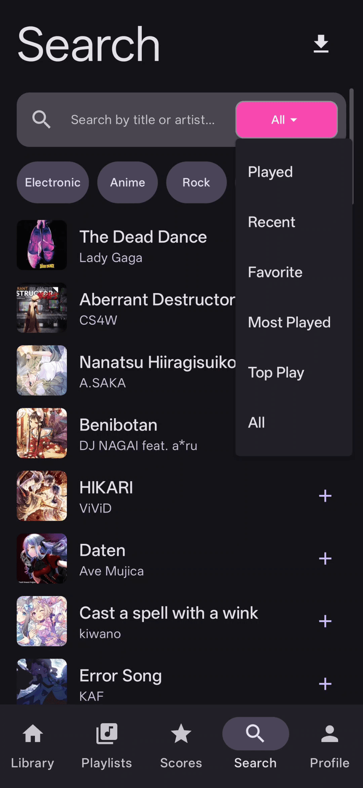
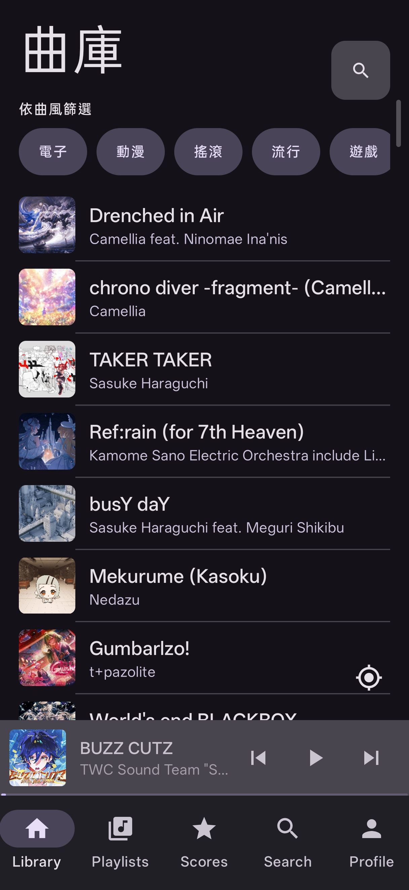
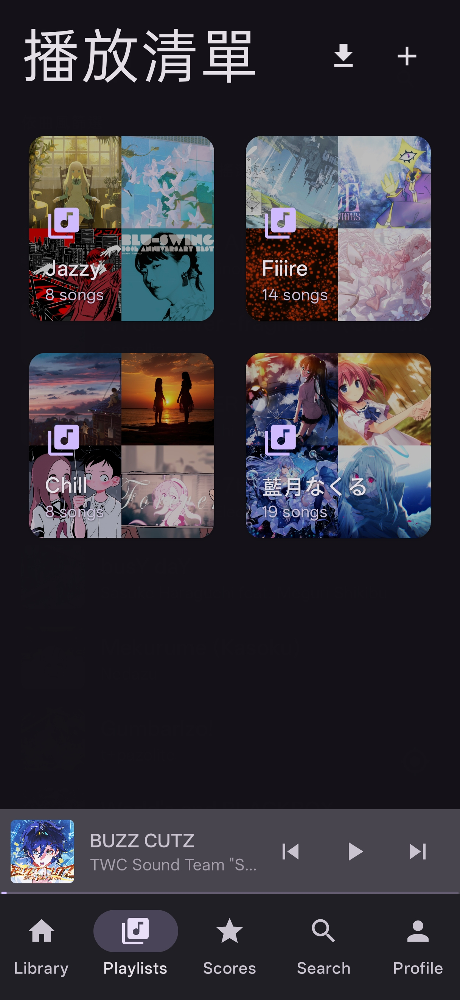
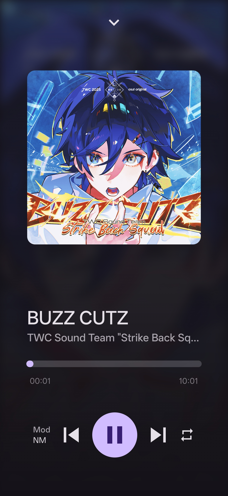
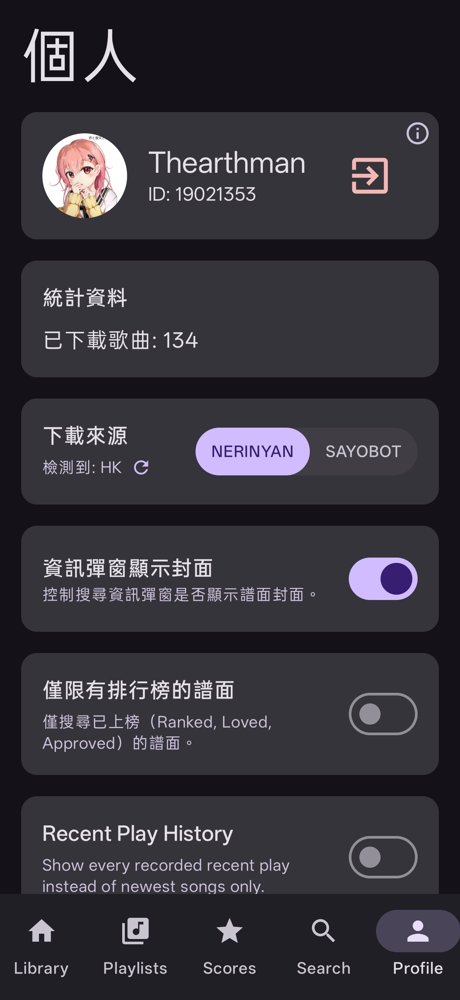
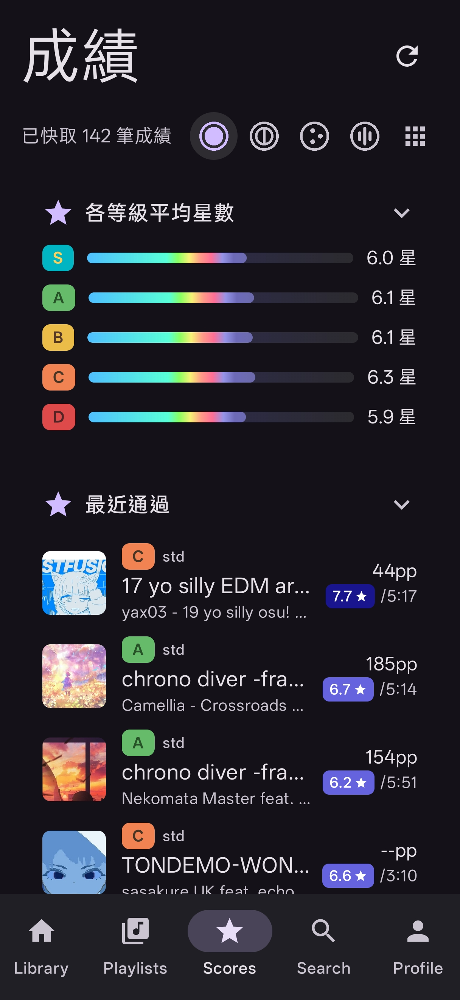
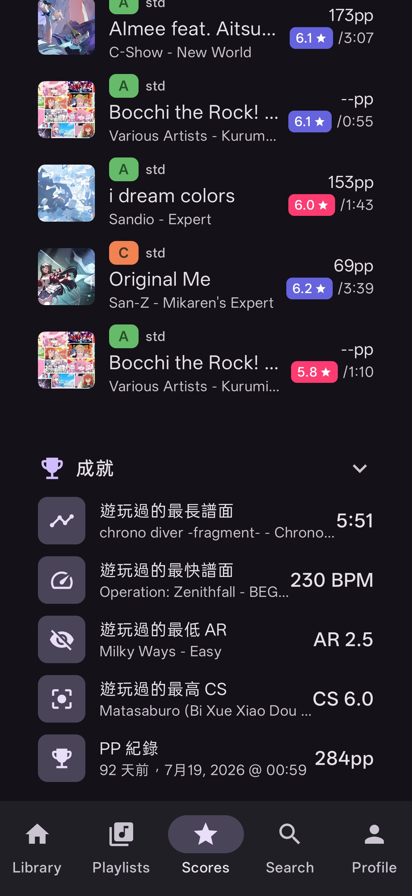
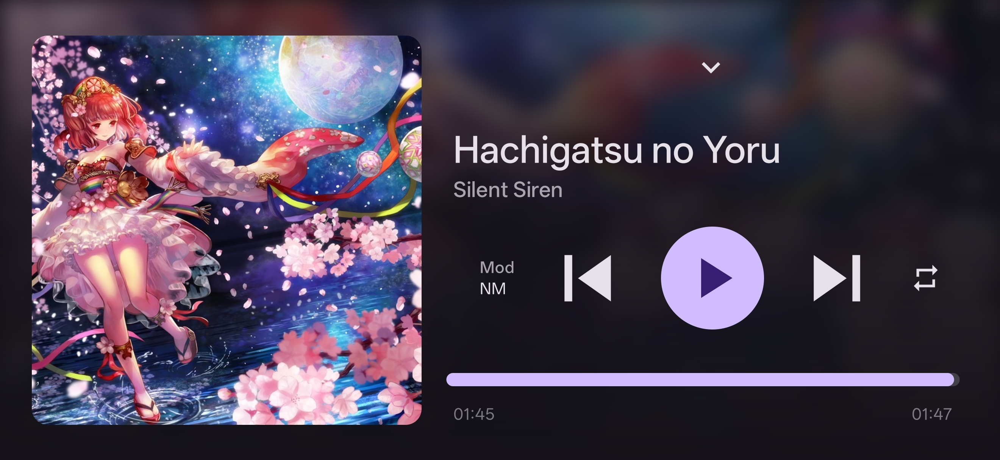

# Mosu — 面向 Android 的离线 osu! 谱面库

## 简介
Mosu 允许您使用 osu! 账号登录，浏览您玩过或收藏的谱面集，从公共镜像下载，并建立离线收藏。它会从每个 `.osz` 中提取音频和封面，将谱面元数据存储在 Room 数据库中，并使用 Media3/ExoPlayer 播放提取出的音频。

## 下载
📥 **最新版本**: [从 GitHub Releases 下载](https://github.com/Thearthman/mosu/releases/latest)

## UI 和页面设计

  
  
  
  

### 功能特性
- OAuth 登录自动令牌刷新和凭据管理。
- 搜索视图（可选择并持久化）：已玩、最近（带时间戳）、收藏、最常玩、全部；在个人资料中全局"包含非排名 (s=any)"切换。
- 高级搜索：按标题/作者合并重复谱面集，增强信息弹窗显示来自 osu API 的所有匹配谱面集（包含难度、星级评分、游戏模式），使用颜色编码的难度梯度，支持手动缓存刷新（下拉刷新）。
- 逐项下载进度；搜索/曲库中下载的项目点击播放。
- 曲库带流派筛选器、搜索栏，以及可滚动/高亮当前播放曲目的定位器；滑动删除或添加到播放列表。
- 播放列表：创建自定义播放列表，添加/移除谱面，长按重命名/删除播放列表，播放列表特定播放模式。
- 播放器：后台播放（Media3），可折叠 MiniPlayer 带控制，展开完整播放器视图；模组选择器（NM/DT/NC）带持久化，确定性随机播放循环，播放模式持久化（单曲/循环/随机）。
- 个人资料：用户信息，下载数量，默认搜索视图设置，包含非排名切换，OAuth 凭据管理，语言选择跟随系统语言环境。
- UI 打磨：精致的媒体播放器风格设计，深色模式，搜索结果中的游戏模式图标，播放器中的单独难度标题，流畅动画，无分割线。

## 成绩页面
**成绩**标签页会将本地缓存的 osu! 近期成绩整合成一个紧凑的仪表盘。成绩会同步 std、taiko、catch 和 mania 四种模式，并可通过模式图标筛选；所选模式会持久保存。本地最多保留 500 条近期成绩，你可以手动刷新，后台也会每日同步。

  
  

- **各等级平均星数**：将已通过成绩按等级（SS、S、A、B……）分组，并显示各等级的平均星级。
- **最近通过**：按时间倒序列出最多 30 条已通过成绩，包含等级、模式、难度、PP、星级和谱面长度。长按条目可打开谱面集信息弹窗。
- **成就**：展示已通过成绩中最长的谱面、最快 BPM、最低 AR、最高 CS，以及缓存成绩中的最高 PP 成绩。

> 成绩统计来自本地缓存的近期成绩（最多 500 条），并非完整的 osu! 个人资料历史。

## 横屏待机播放器
横屏时，完整播放器会切换为宽屏 CarPlay 风格待机界面，展示大尺寸封面、曲目信息、播放控制、进度条、模组和随机播放控制。

  

## 设置教程

### 1. 前置条件
- 一个 osu! 账号，您需要从 https://osu.ppy.sh/home/account/edit 获取 OAuth 应用凭据（客户端 ID/密钥）。

> **重要**：如何获取您的 OAuth 密钥：
> 1. 前往 https://osu.ppy.sh/home/account/edit
> 2. 向下滚动找到 "OAuth" (开放授权) 部分
> 3. 点击 "New OAuth Application"
> 4. 将 **Application Callback URL** 设置为：`mosu://callback`（无尾随斜杠！）
> 5. 为您的应用命名（例如："Mosu"）
> 6. 点击 "Register application"
> 7. 复制您的 **Client ID** 和 **Client Secret**（两者都需要）

### 2. 配置 OAuth（登录必需）
- 启动应用，前往个人资料 → 配置凭据。
- 输入您的 osu! OAuth 客户端 ID 和密钥；它们通过 DataStore 本地存储。
- 登录将通过 `mosu://callback` 重定向（已在清单中配置）。

### 3. 使用提示
- 搜索：通过下拉菜单选择视图（已玩/最近/收藏/最常玩/最高分/全部）；流派标签；下拉刷新缓存；长按获取增强谱面信息弹窗，显示所有匹配谱面集并带颜色编码难度梯度；短按播放已下载谱面的音频。
- 曲库：流派筛选；搜索栏；左滑删除，右滑添加到播放列表；右下角定位按钮可滚动/高亮当前曲目。
- 播放列表：创建自定义播放列表；长按播放列表重命名/删除；在播放列表中，右滑从播放列表移除，左滑从曲库删除。
- 播放器：点击 MiniPlayer 展开；拖拽进度条；循环播放模式（单曲/循环/随机）；DT/NC 效果模组选择器；模组跨曲目持久化。
- 成绩：使用模式图标在 std、taiko、catch、mania 和全部之间切换；点击面板标题可折叠或展开；长按最近通过的成绩可查看谱面集详情。
- 个人资料：用户信息，下载数量，默认搜索视图设置，包含非排名切换，OAuth 凭据管理，语言选择跟随系统语言环境。

### 4. 注意事项
- 下载源使用镜像；音频/封面从 `.osz` 提取并存储在应用文件下。
- Room 数据库版本 5，开发期间使用破坏性迁移。
